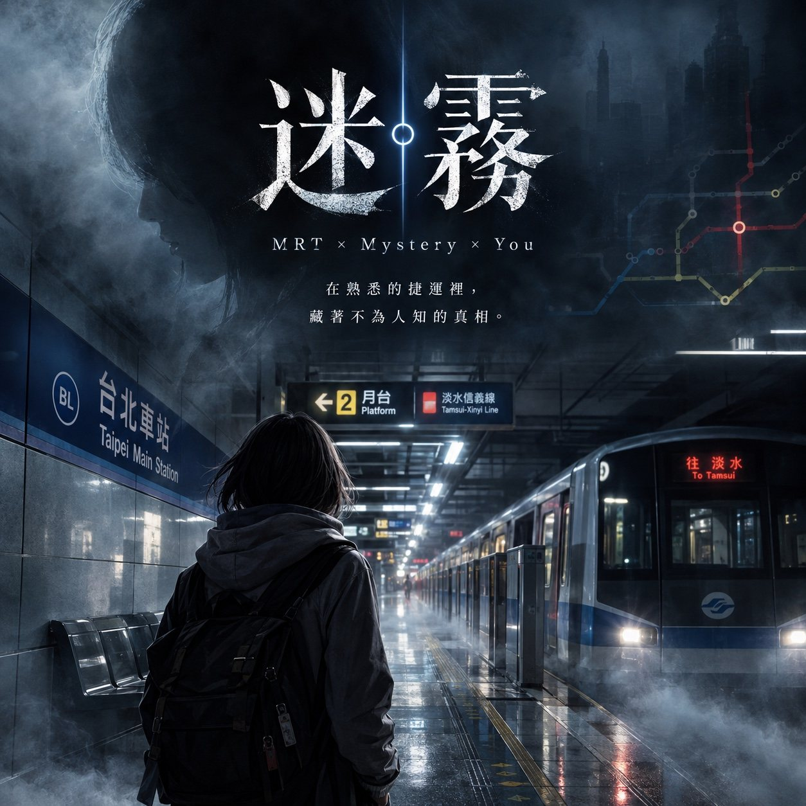

# 迷霧



**大型開放 RPG 網頁遊戲**。以台北捷運為舞台的 3D 開放世界：選擇男主或女主、替角色取名字，從南港展覽館出發，在台北捷運 118 站之間自由搭乘探索。沒有計時、不分難度，進度自動存在瀏覽器裡。

> MRT × Mystery × You——在熟悉的捷運裡，藏著不為人知的真相。

## 怎麼玩

1. 選擇**男主或女主**，替角色**取名字**（2–6 個字，中文或英文大小寫），從**南港展覽館**出發。已經在玩的玩家，背包會收到一張「改名卡」，可以改成自己取的名字
2. 車站是多樓層的：大廳（閘門、售票機、詢問處、出口、電梯）＋各線的島式月台，搭電扶梯或走樓梯上下
3. 每條線一座島式月台，**走到月台哪一側就搭往那個方向的車**；每個方向 **13:00–18:00、20:00–22:00 每 1 分鐘一班，其他時間 3 分鐘一班**，依台灣真實時間倒數進站（月台 LED 看板會顯示）
4. 列車進站（各路線有自己的進站音樂），車門開 20 秒：**自己走進車門就上車**，沒趕上就等下一班
5. 到站開門時走出車門就下車，留在車上會繼續開往下一站
6. **轉乘要真的走**：轉乘站各線月台在不同樓層、不同位置，要搭電扶梯上大廳、跟著指標走到另一條線的月台
7. **傳送**：到過的車站會在 3D 地圖上解鎖，點車站就能傳送過去（搭車時不能傳送）。每天免費 3 次，超過的依兩站之間的捷運票價扣款
8. 搭到任一路線的**終點站**就會得到該路線的物品，共 6 件
9. 路線收藏：每條線的終點各有一件紀念物
10. **站內導航**：點資訊框上的 🧭 看樓層、月台方向、轉乘與任務指引
11. **大型車站**：南港展覽館（出發站：旅客廣場、便利商店、新手指南看板、委託所的林姐）、台北車站、西門、中山、忠孝復興、板橋、大安、動物園有 2–3 層樓，台北車站還有地下街
12. **貓空纜車**：完成動物園的專屬任務後解鎖，動物園、動物園內、指南宮、貓空四個纜車站
13. **車站限定小舖**：非付費區的推車只賣那一站的在地小吃、紀念品，少數站有特別道具（象山登山杖、龍山寺平安符、台北車站限定悠遊卡）

### 角色扮演

- **錢與等級**：起始 NT$500；進站要有 20 元以上，**出站時依台北捷運票價規則扣款**（5 公里內 20 元，之後每 3 公里加 5 元，最高 65 元）。完成任務、找到秘密可以拿到錢與經驗值升級
- **任務**：每條線一條主線（由秀蔅給，可以同時進行）、支線同時最多 10 個，還有節慶限時活動
- **主線**：只在那條線上解。該線**每一站的月台都有一個委託**，種類有：秀蔅紙條上的謎題、幫 NPC 找回忘在別站的東西、帶第一次搭捷運的人坐到某一站、帶迷路的人到月台正確的那一側、去別站找人傳話、去有商店的大站幫忙買東西、照著謎語找出神秘通道、撿回散落在不同樓層的零錢。全部完成後，寶物會出現在該線隨機一站，只能靠「寶物感應」（離寶物多遠）自己去找
- **主線劇情**：每條線有五個劇情站，取代原本那一站的委託，要照章節順序解開。各線的形式不同：板南線是多站串聯＋犯罪調查、文湖線是科技懸疑＋救援、淡水信義線是歷史記憶、松山新店線是社會事件＋救援、中和新蘆線是追捕與逃脫＋陣營衝突、環狀線是城市秘密。收集證據、做選擇、追嫌疑人（限時、不能傳送）、甩掉跟蹤者、最後推理真相。找到寶物時依證據和推理揭曉結局（真結局／一般結局／遺憾結局），在小碧潭交出寶物時，擺渡人說的話也會不同
- **支線**：同時最多 10 個。有找東西、送件、推理、人物故事、打工等五十多個。觸發方式有：找 NPC、聽見路人對話、車站廣播、手機訊息、公告欄、撿到物品、用相機拍到、前置任務完成、特定時段偶遇、持有某樣東西。結局會依線索和選擇不同：完整成功、一般成功、意外結果、選擇不同、隱藏資訊、特殊結局；限時任務失敗會留下補救任務
- **任務場所**：市政府站有 Leo 的咖啡店（可以點咖啡、打工），東門站有街頭藝人表演區，收藏品商人老 K 每天在不同的站擺攤，台北車站的便利商店有店員小芬
- **相機**：在西門買，或從 Mia 的支線拿到；在背包裡按「拍照」，有些東西只有拍下來才看得到
- **成就與收集**：遊戲裡不會事先列出，解鎖了才出現在「任務」最下面。包括每站服務台旁的紀念章、散落各站的舊車票與照片碎片、月台椅子下的紙條、只有人少時才看得到的東西、只有相機拍得到的符號、城市景色、NPC 的留言本、整站調查、整條線探索、圓山的新舊地圖對照、國父紀念館的磁磚謎題、景美只開到上午 10 點的早餐攤、只在早上 7 點出現的雨晨、每天換通勤路線的張先生、放太久會被清潔人員收走的失物、每天早上公告欄的城市傳聞
- **紀錄**：角色等級與能力（觀察、推理、人緣、體力，升級得點數自己分配）、稱號、城市探索度、案件評價（S／A／B／C）、收藏完成度、人物檔案、區域聲望（幫某區居民會提升，店家打折、好感加成、稱號）
- **好感度**：陌生、認識、朋友、信任、摯友。每升一級有專屬對話和小禮物；信任會開啟隱藏人物檔案；摯友的店打折。每天第一次聊天加比較多，同一個人一天只能送一次禮
- **黃金**：秘密任務、稀有探索事件、特殊案件、節慶活動才拿得到。用來跟隱藏店家「霧商人」買特殊外觀、稀有收藏、探測器等道具，還有迷霧時刻（00:30–06:00）隱藏區域用品（迷霧時刻開放後才能用）
- **城市生活**：
  - 街頭表演：西門街舞、台北車站小提琴、中山吉他、市政府魔術、淡水、公館、板橋，依時段出現，聽得到音樂，可以打賞
  - NPC 在售票機、販賣機、商店前排隊，在月台車門前候車，尖峰時段快步通勤，買完東西提著袋子走
  - 大廳與月台的長椅可以坐下休息、閱讀調查筆記、查看收藏
  - 廣告海報可以查看並收進海報圖鑑；閘門旁有路線指南
  - 各區店家不同：淡水阿給鐵蛋、北投溫泉蛋、劍潭夜市、動物園貓空鐵觀音、松山胡椒餅、龍山寺平安符、公館豆花；還有求籤、泡腳、畫像等服務
  - 「紀錄 → 生活」有購物清單（任務要買的東西和哪裡買）與每天的生活紀錄
- **秘密任務**：遊戲裡完全不會提示，玩家真的做了某件事才會出現
- **限時任務**：有些 NPC 只在特定時段出現（晨跑族早上、外送員中午、保全晚上……），他們給的任務接下後要在時間內完成（10–40 分鐘，畫面上方會倒數）。時間到就失敗，當天不能再接，要之後或明天再來
- **小碧潭的渡口**：六條主線完成、拿到六件寶物後，帶到小碧潭交給擺渡人，路網圖上才會出現**桃園機場捷運**（A1 台北車站～A22 老街溪），並且可以在台北車站、三重、新北產業園區轉乘。交出寶物前，地圖上看不到、車站裡也沒有它的月台
- **秀蔅**：開場在南港展覽館要你選板南線或文湖線的主線；之後每到一條新路線，她會出現在那一站，要自己找到她才能接那條線的主線
- **NPC**：依時段出現（上班族、學生、長輩、觀光客、站務員、清潔人員、捷運警察、外送員、小朋友、晨跑的人、外國旅客……），還有將近三十位有名字的人（清潔阿姨阿芳、捷運警察志明、退休的王老師、夜班保全老周、淡水的街頭畫家……）。可以聊天、送禮、累積好感，熟了會告訴你傳聞、幫你傳話
- **車站設施**：閘門（含寬閘門）、售票機、加值機、詢問處、失物招領、廁所（男／女／無障礙）、垃圾桶、哺集乳室、站務室、電梯、電扶梯、樓梯、飲水機、AED、消防栓、緊急對講機、月台緊急停止按鈕、監視器、廣播喇叭、時鐘（顯示台灣時間）、公共藝術、廣告燈箱、自動販賣機、資源回收桶、車站周邊地圖、首末班車時刻表、公共電話、夜間婦女候車區、博愛候車區、車門編號，大站另有置物櫃、ATM、商店。大部分都可以走過去查看或使用
- **車廂生活**：車上有乘客，可以坐下、聊天、撿遺落物；窗外偶爾會出現不該存在的月台
- **探索**：電梯、售票機、路線圖、告示、塗鴉、角落的紙條與硬幣，大廳內容會隨時段變化
- **商店**（只有大站有）：台北車站、西門、南港、中山、市政府、板橋、忠孝復興，賣吃的、喝的、伴手禮；**在捷運裡可以吃東西**，背包裡的食物可以吃掉
- **換裝**：西門、忠孝復興、市政府、中山、板橋買衣服、褲裙、鞋子、包包、帽子眼鏡耳機；台北車站地下街髮廊可以換髮型、染髮。背包 → 換裝隨時更換
- **節慶活動**：雙十節（10/8–12）、萬聖節（10/15–31）、聖誕節（12/18–25）、跨年（12/30–1/1）、春節、中秋節、情人節（2/13–14），依台灣日期自動開始，有限定商品與限定配件

### 新手教學、雲端存檔、設定

- **新手教學**：剛建立角色時可以選擇跟著走一遍（搭電扶梯到月台 → 搭第一班車 → 下一站下車 → 免費傳送回來 → 找林姐接委託），完成送 NT$100；也可以直接跳過，之後在「選單 → 設定」重新開始
- **雲端存檔**：在夜語工作室（大廳）登入帳號，遊戲會自動把進度同步到雲端（Supabase `game_saves` 表，只能讀寫自己的），換手機或電腦也能繼續；雲端比較新時會先問要用哪一份
- **設定**（選單 → 設定，標題畫面也有）：畫質（自動／高／省電；自動會依幀率調解析度，裝置太吃力時減少人潮）、音量分四組（總音量、音效、環境音、廣播）、字體大小（標準／大／特大）、減少晃動
- **回報問題**：選單或設定頁的「🐞 回報問題」，寫下發生什麼事就會送出（自動附上所在車站、位置、裝置、最近的錯誤訊息），存到 Supabase `bug_reports` 表（只能新增、不能讀）
- **分享截圖**：選單 →「📷 分享截圖」，把目前畫面做成附站名、路線色、角色名字與時間的圖卡，手機可以直接分享，電腦可以下載
- **加到主畫面（PWA）**：可以安裝到手機桌面或電腦，全螢幕開啟；第一次開啟後的檔案會快取，之後載入更快、斷網也能開啟標題畫面
- **載入**：標題畫面一打開就顯示封面與載入進度，程式在背景載入，載入完才出現「開始」

### 操作

- 電腦：方向鍵／WASD 走動、Shift 跑步、拖曳畫面轉視角、滾輪拉近拉遠、E／空白鍵／Enter 互動
- 手機：左下角搖桿走動、「跑」按鈕跑步、單指拖曳轉視角、**雙指捏合縮放**、右下角按鈕互動；開始遊戲時會進入全螢幕（直式、橫式都可以）
- 路網圖：台北捷運全路網 3D 地圖，拖曳移動、滾輪或雙指縮放、右鍵拖曳或雙指旋轉；還沒去過的車站藏在霧裡

## 時間

遊戲使用台灣真實時間（Asia/Taipei）。

| 時段 | 狀態 |
|---|---|
| 06:00 – 00:30 | 捷運營運中（白天 06:00–12:30 大家忙著上班上學，不太聊霧的事） |
| 00:30 – 06:00 | 迷霧之城：車站被霧封閉，有生命值、黃金商店與每一站不同的事件 |

**霧夜短篇**：迷霧之城每一站的事件都是一篇有名字的完整短篇（共 118 篇，例如《沒有走完的那一分鐘》《雨停在鈴響之前》《鐵捲門落下以前》），有開場、線索與依表現不同的結局（完美／一般／苦澀）。讀過的篇章收在「任務 → 📖 霧夜短篇集」，讀到一定篇數會收到秀蔅夾在書裡的書籤。鬼列車會開往它自己的鬼站，是同一篇故事的下半部；機場線開通後，機場線各站也有自己的小故事。

高架車站與高架段的天色會依時間變成白天、黃昏、夜晚或清晨。

測試時可以在網址後加 `?time=23:55` 模擬台灣時間，例如 `index.html?time=00:28`。

## 路網

台北捷運 6 條路線，共 118 站，含支線與轉乘站：

- 文湖線 BR01–BR24
- 淡水信義線 R01–R28，含新北投支線 R22A
- 松山新店線 G01–G19，含小碧潭支線 G03A
- 中和新蘆線 O01–O21、O50–O54（在大橋頭分往迴龍、蘆洲）
- 板南線 BL01–BL23
- 環狀線 Y07–Y20

## 音效

全部用 Web Audio 即時合成：六條路線各自的進站旋律、車廂「叮咚」提示音、關門警示音、車門氣動聲、列車馬達變頻聲、軌道接縫聲、月台環境音；到站廣播用瀏覽器語音合成念中英文。

若在 `assets/sounds/` 放入 `arrive-BR.mp3`、`arrive-R.mp3`…等檔案，進站音樂會優先播放音檔。詳見 `assets/sounds/README.md`。

## 執行

純 HTML/CSS/JavaScript，不需要安裝套件。用任何靜態伺服器打開即可：

```bash
python3 -m http.server 8000
# 開啟 http://localhost:8000
```

也可以直接用 GitHub Pages 發佈。

## 檔案結構

```
index.html
css/style.css
js/vendor/three.min.js  Three.js（MIT）
js/data.js        路網資料（車站、路線、站碼、轉乘、地下/高架）
js/characters.js  主角資料（男主／女主）
js/settings.js    設定頁（畫質、音量、字體、減少晃動）
js/tutorial.js    新手教學（可跳過）
js/cloud.js       雲端存檔（夜語工作室帳號）、問題回報
js/report.js      回報問題（錯誤紀錄、裝置資訊）
js/share.js       分享截圖、PWA 安裝
js/playername.js  玩家自己取的名字、改名卡
js/economy.js     票價（最短路徑距離）、等級
js/quests.js      物品、主線／支線／節慶／秘密任務與進度
js/puzzles.js     主線每一站的委託與謎題（答案由路網資料計算）
js/story.js       主線劇情章節與結局
js/sidequests.js  支線擴充：角色、觸發、結局、打工、相機
js/achievements.js 成就與收集品
js/progress.js    紀錄：能力、探索度、評價、收藏、聲望；任務報酬與難度
js/gold.js        黃金、霧商人、好感度等級、隱藏人物檔案
js/life.js        城市生活：各區店家與服務、街頭表演、長椅、海報、購物清單、生活紀錄
js/outfits.js     換裝：服裝目錄、哪裡買得到
js/human3d.js     3D 人物模型（主角、NPC、換裝、走路與坐下動畫、手繪五官）
js/npcs.js        NPC 作息與對話、秀蔅、車廂乘客、任務物品、車站裡的秘密
js/station3d.js   多樓層車站（大廳、月台、電扶梯、設施）、列車、隧道/高架的建造
js/world3d.js     3D 執行：角色、鏡頭、多樓層碰撞、電扶梯、列車進出站與搭乘
js/map3d.js       台北捷運全路網 3D 地圖
js/time.js        台灣時間、營運時段、班距（尖峰 1 分鐘、其他 3 分鐘）
js/audio.js       合成音效與廣播
js/game.js        遊戲流程
assets/sounds     進站音檔（選用）
assets/icons      App 圖示
manifest.webmanifest, sw.js  PWA（安裝、離線快取）
```
